<p align="center">
  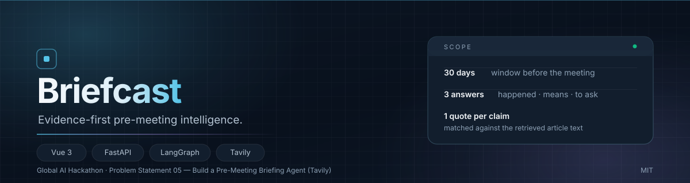
</p>

<p align="center">
  <strong>Evidence-first pre-meeting intelligence.</strong><br>
  Turn the 30 days before a meeting into three answers you can defend.
</p>

<p align="center">
  English · <a href="README.zh-CN.md">简体中文</a>
</p>

---

## The two hours before the meeting

The meeting is not the expensive part. The two hours before it are: scanning news, changelogs and social posts, then trying to remember what the other side actually shipped last month.

Search gives you links. It does not tell you which link matters for *this* conversation, or why you should believe it.

Briefcast makes that process repeatable. Give it a subject, a meeting time and a goal. It researches the 30-day window before the meeting, traces every claim back to a verbatim sentence in the article text, and turns verified facts into questions you can ask out loud.

## What it answers

| | Answer | What you get |
|---|---|---|
| **01** | **What happened** | Up to four verified developments on a timeline, each with a date basis and a source quote |
| **02** | **What it means** | An explicitly framed meeting implication, kept visually separate from the facts |
| **03** | **What to ask** | Up to three questions, each bound to a specific development; one click returns to the evidence |

<p align="center">
  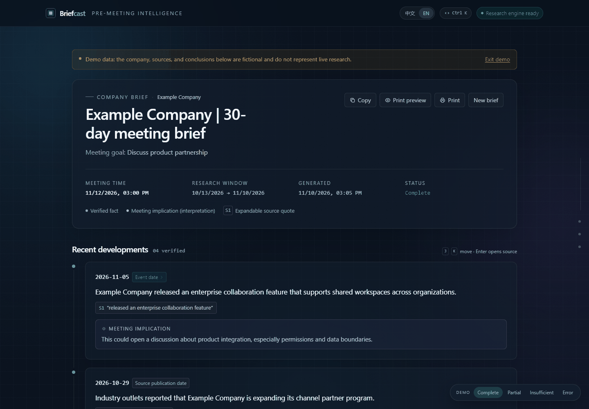
</p>

## The evidence model

This is not a summarizer with a source list. It is a pipeline that refuses to promote unverified text.

- **Claims need quotes.** Every development carries `[S1]` to a passage that was matched against the retrieved article text.
- **Dates have a basis.** `explicit_event_date` means the article states when it happened; `source_publication` means only the publication date is known.
- **Snippets are not quotes.** Search summaries are labeled as search summaries and never presented as article text.
- **Inference is labeled.** Meeting implications live in their own block, separate from verified facts.
- **Silence is allowed.** If the evidence is insufficient, the brief says `insufficient_evidence` instead of filling the page.

## Tech stack

| Layer | Technology | Role |
|---|---|---|
| Interface | Vue 3.4, TypeScript, Vite 5, Vue Router 4, Tailwind CSS 3 | Single-page brief reader, demo modes, A4 print layout |
| Streaming | Native `fetch()` + `ReadableStream` SSE parser | POST a JSON body and render progress events as they arrive; `EventSource` only supports GET |
| API | Python 3.11, FastAPI, Pydantic v2, Uvicorn | Typed validation, async endpoints, `text/event-stream` responses |
| Agent graph | LangGraph 1.x | Explicit six-node state machine with a bounded research loop |
| Model | DeepSeek `deepseek-flash` via the OpenAI-compatible API | Query planning, drafting, strict evidence auditing, question composition |
| Retrieval | Tavily news search + full-text extraction | Recent coverage with article text for quote verification |
| Quality | pytest, httpx, vue-tsc, GitHub Actions | 36 backend tests, type-checked production build, CI on every push |

## Product tour

### 01 — Input

Subject and meeting time are all that is required. Company/person type, organization, domain and attendee stay collapsed until you need them.

<p align="center">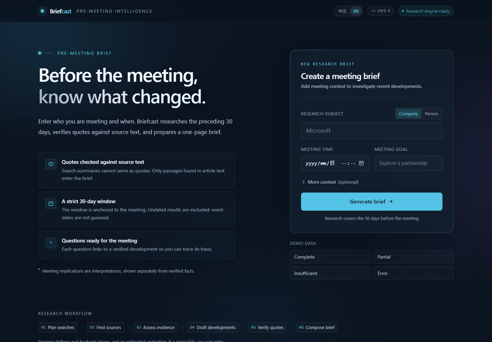</p>

### 02 — Live research progress

Progress is not a decorative animation. Six stages (`plan → search → assess → draft → verify → compose`) come from real SSE events pushed by the backend. The live event stream shows the actual elapsed time and source counts for each stage.

<p align="center">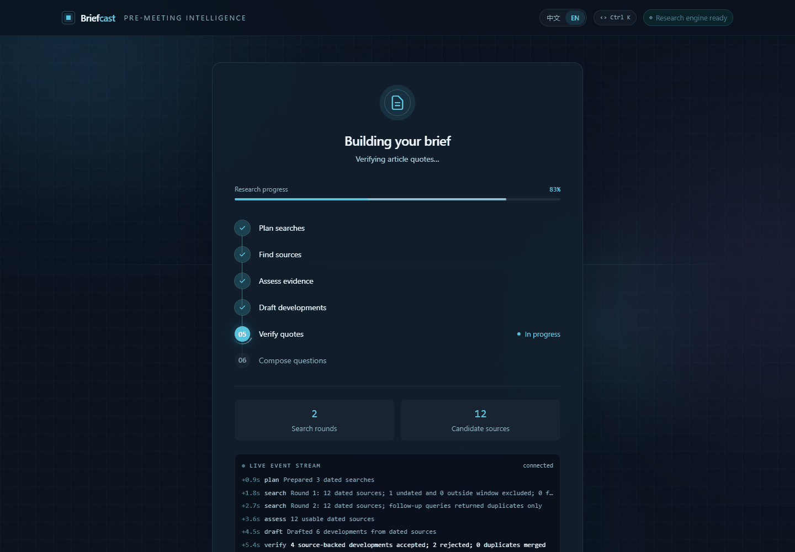</p>

### 03 — Source drawer

Click any `[S1]` citation to open the full source: original quote, title, publication date, source type, retrieval time, search query, search summary (explicitly marked **not a quote**), and the original URL. Date labels are clickable too — they open the sentence that supports the date.

<p align="center">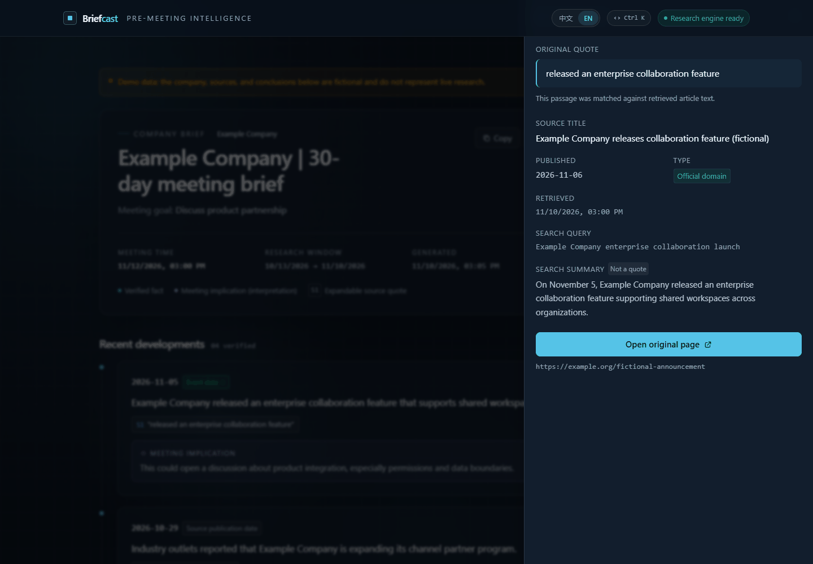</p>

### 04 — A4 print layout

Printing is not a squeezed webpage. It is a separate newspaper-style layout: developments on the left, questions and sources on the right, with complete URLs for offline reading and meeting notes.

<p align="center">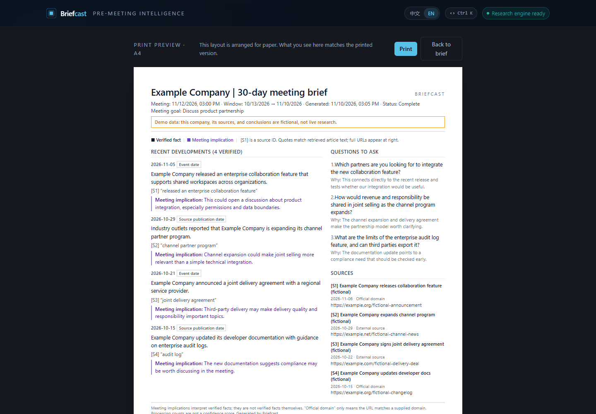</p>

### 05 — Command palette and keyboard flow

`⌘K` / `Ctrl K` opens the command palette: jump between views, copy the brief, open print preview, switch demo state or change the interface language. On the result page, `J` / `K` move between evidence, `Enter` opens the current source, and `Esc` closes any overlay.

<p align="center">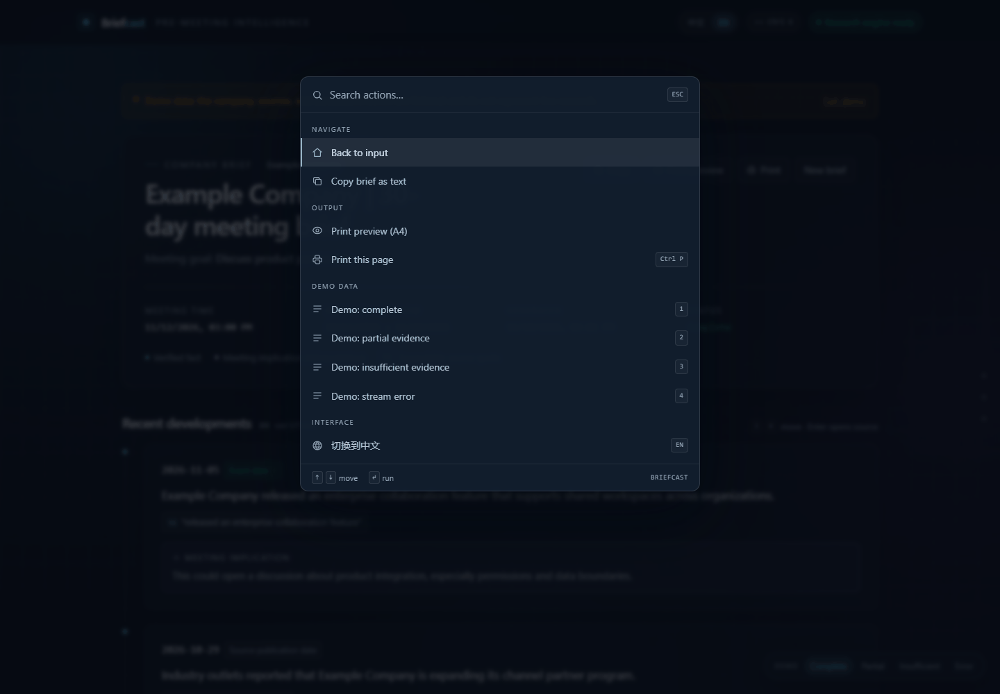</p>

### 06 — Bilingual by design

Interface, demo data, source notes, copied text and the print layout all support Chinese / English. The choice is stored locally and becomes the default language for new briefs.

<p align="center">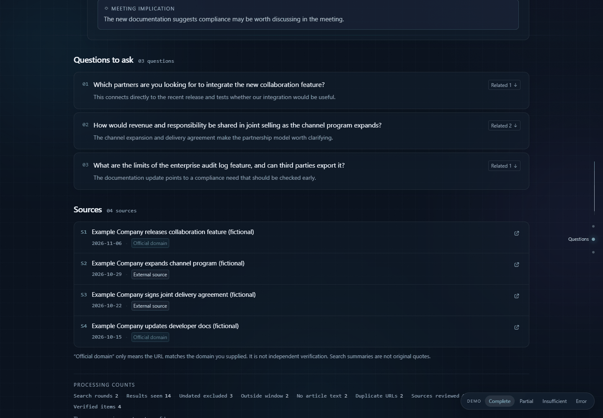</p>

### 07 — Mobile

At phone width the timeline becomes a single column, the reading rail and hover effects turn off, and animations degrade gracefully without losing information density.

<p align="center">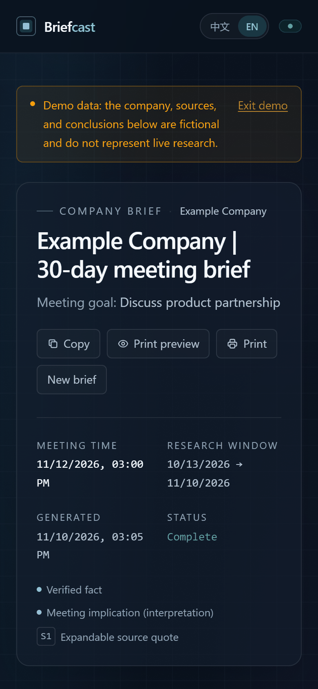</p>

### 08 — Edge states

| State | Behaviour |
| --- | --- |
| `completed` | Normal brief |
| `partial` | Shows verified material and lists the research gaps |
| `insufficient_evidence` | Says there is no verifiable recent activity; **does not fill the page** |
| stream interrupted / `error` | Explains the interruption and offers retry without losing completed work |

<p align="center">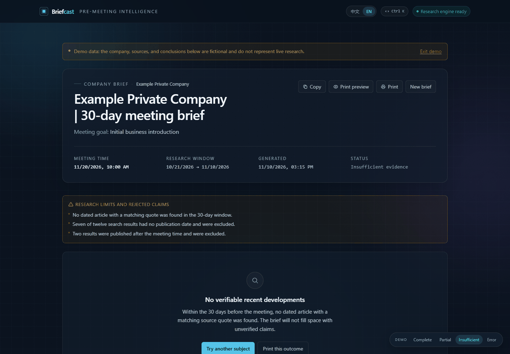</p>

## Architecture and implementation

<p align="center">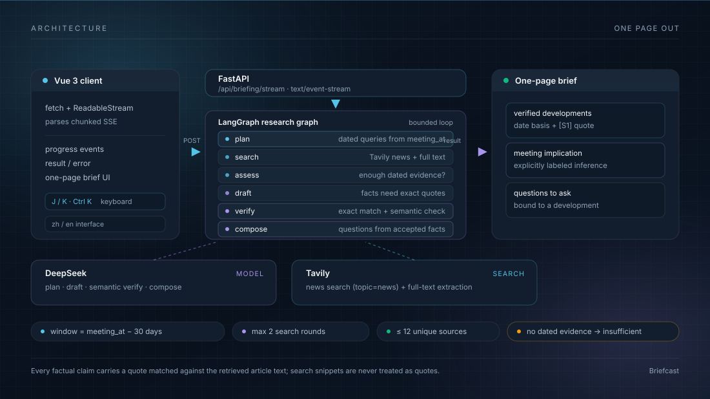</p>

### Request lifecycle

1. The Vue input view sends a JSON body to `POST /api/briefing/stream`.
2. FastAPI validates `meeting_at` (a timezone is required) and derives the research window: `[meeting_at - 30 days, min(meeting_at, now)]`.
3. The LangGraph state machine runs `plan → search → assess → draft → verify → compose`.
4. Each node appends a trace step; the API forwards every step as an SSE `progress` event.
5. The browser parses the stream with `fetch()` + `ReadableStream`, updates the six-stage progress UI, then renders the final `result` event.
6. The screen view, print preview and copied text all consume the same result object. There is no second model call.

### Pipeline stages

| Stage | What happens | Guardrail |
|---|---|---|
| `plan` | Builds up to three targeted news queries from the subject, meeting goal and window, plus a `site:` query when an official domain is provided. | A window entirely in the future returns `insufficient_evidence` without searching. |
| `search` | Calls Tavily news search (`topic=news`, advanced depth, raw article text); normalises URLs and removes duplicates. | At most two rounds and twelve unique sources; undated, out-of-window and text-less results are rejected. |
| `assess` | Checks whether the dated evidence is sufficient; if not, proposes focused follow-up queries. | Stops at three usable dated sources or two rounds, so the loop is bounded. |
| `draft` | Asks the model for up to four distinct developments: fact, meeting implication, exact quote, optional event date and date quote. | Search summaries are explicitly forbidden as quotes. |
| `verify` | Checks every quote against retrieved article text; validates event dates; checks identity and 30-day timing; detects duplicates; runs a second strict evidence audit. | Unsupported, ambiguous or out-of-window candidates are dropped; at most four verified developments survive. |
| `compose` | Writes meeting questions bound to verified development IDs and sets the final status. | No verified developments → `insufficient_evidence`; material gaps → `partial`; otherwise `completed`. |

### Deterministic assembly

The model never gets to invent the source layer:

- URLs, titles, publication dates, retrieval timestamps and source type are written by the backend from Tavily metadata.
- `date_basis` is either `explicit_event_date` (the article states the event date) or `source_publication` (publication date used as a proxy).
- Search summaries are stored separately and labelled “search summary — not a quote”.
- Processing counts are counts of retrieved or rejected items, not confidence scores.

### Frontend implementation

- Vue 3 Composition API with module-level composables keeps the input run and the result page on the same state.
- SSE is parsed manually because `EventSource` only supports `GET`; the client buffers lines across chunk boundaries and handles `progress`, `result` and `error` events.
- `PrintBriefing` / `PaperPreview` render the same result in a dedicated A4 newspaper layout.
- The command palette, evidence keyboard navigation (`J` / `K`), reduced-motion fallback and mobile single-column layout are all implemented in the client.

### Repository layout

```text
src/sourcebound/
  api.py          FastAPI app, CORS, SSE endpoints
  briefing.py     six-node LangGraph briefing pipeline
  providers.py    DeepSeek and Tavily adapters
  schemas.py      Pydantic request/response models
frontend/src/
  api/client.ts   POST + ReadableStream SSE parser
  composables/    shared run state, locale, demo mode
  components/     brief, source drawer, print, progress, command palette
  views/          input and briefing routes
tests/            36 backend tests with fake providers
docs/             contracts, evaluation records, engineering notes
```

## Requirement coverage

| Hackathon requirement | How Briefcast implements it |
| --- | --- |
| **Meeting context** — company/person and meeting time | Company or person input; `meeting_at` requires a timezone; optional organization, domain and attendee disambiguate |
| **Recent research** — last 30 days | Window is **30 days before the meeting**, covering launches, channels, partnerships, people and funding; up to two search rounds |
| **Concise briefing** — one structured page | Single-page screen layout; a separate **one-page A4** print layout (verified with `--print-to-pdf`) |
| **Source attribution** — verifiable facts | Every fact has an `[S1]` quote with expandable excerpt, title, publication date, retrieval time, query and original URL; **search snippets are never treated as quotes** |
| **Open questions** — usable in the meeting | Up to three questions, each bound to a development; click to return to the evidence |
| Guidance — separate verified from uncertain | Facts and meeting implications are separated structurally and visually; quotes are exact-matched and semantically checked; insufficient evidence returns `insufficient_evidence` |
| Guidance — use Tavily | Tavily news search (`topic=news`, date range, full-text extraction) with date, domain and duplicate gates |

> The brief's original warning still holds: AI summaries often present unsupported material as fact. Briefcast treats that as the core problem: **unverified developments never enter the brief**, and every number on screen is a processing count, not a confidence score.

## Installation

### Prerequisites

- Python 3.11+
- Node.js 18+ (20 LTS recommended)
- A DeepSeek API key and a Tavily API key for live research
- Windows PowerShell, macOS or Linux — commands for both shells are below

### 1. Clone and configure

```powershell
git clone https://github.com/97Three/briefcast.git
cd briefcast
Copy-Item .env.example .env      # Windows PowerShell
```

```bash
git clone https://github.com/97Three/briefcast.git
cd briefcast
cp .env.example .env             # macOS / Linux
```

| Variable | Required | Default | Purpose |
|---|---|---|---|
| `DEEPSEEK_API_KEY` | Yes | — | DeepSeek model calls for planning, drafting and verification |
| `TAVILY_API_KEY` | Yes | — | Tavily news search and full-text extraction |
| `DEEPSEEK_MODEL` | No | `deepseek-flash` | Model name passed to the OpenAI-compatible API |
| `DEEPSEEK_BASE_URL` | No | `https://api.deepseek.com` | API base URL |
| `FRONTEND_ORIGINS` | No | `http://localhost:3000,http://localhost:5173` | CORS allow-list |
| `VITE_API_BASE_URL` | No | empty (same-origin `/api`) | Frontend-only setting for split deployments; never put secrets here |

Keys live only in the project-root `.env`. They **never enter frontend code, browser requests or build output**.

### 2. Start the backend

Windows:

```powershell
python -m venv .venv
.\.venv\Scripts\python.exe -m pip install -e ".[dev]"
.\.venv\Scripts\python.exe -m uvicorn sourcebound.api:app --reload
```

macOS / Linux:

```bash
python3 -m venv .venv
source .venv/bin/activate
python -m pip install -e ".[dev]"
python -m uvicorn sourcebound.api:app --reload
```

The API listens on `http://127.0.0.1:8000`.

### 3. Start the frontend

In a second terminal:

```bash
cd frontend
npm install
npm run dev
```

Vite serves `http://localhost:5173` and proxies `/api` to `127.0.0.1:8000` by default. On Windows, `start-dev.bat` / `start-dev.ps1` launches both processes.

### 4. Verify the installation

```bash
curl http://127.0.0.1:8000/api/health
```

Expected response:

```json
{"status":"ok","deepseek_configured":true,"tavily_configured":true}
```

Open the app and run a live brief, or use the demo states below. Demo mode works without API keys; live research returns HTTP 503 until both keys are configured.

| URL | What it shows |
| --- | --- |
| `http://localhost:5173/` | Input page |
| `http://localhost:5173/briefing` | Real run (SSE progress → brief) |
| `http://localhost:5173/briefing?demo=completed` | Demo state (`partial` / `insufficient` / `error`) |
| `http://localhost:5173/briefing?demo=completed&paper=1` | One-page A4 print preview |

### Troubleshooting

| Symptom | Fix |
|---|---|
| HTTP 503 on a live run | Add both keys to `.env` and restart Uvicorn |
| HTTP 422 | `meeting_at` must include a timezone offset, e.g. `+08:00` |
| Frontend cannot reach the API | Keep the backend on port 8000, or update the `/api` proxy in `frontend/vite.config.ts` |

## API

| Method | Purpose |
| --- | --- |
| `GET /api/health` | Configuration status; never returns credentials |
| `POST /api/briefing` | Same request body, returns the final JSON |
| `POST /api/briefing/stream` | Main flow: `progress` events, then `result` or `error` |

```json
{
  "entity": "Microsoft",
  "entity_type": "company",
  "official_domain": "microsoft.com",
  "meeting_at": "2026-11-26T15:00:00+08:00",
  "meeting_goal": "Discuss an enterprise AI partnership",
  "language": "en"
}
```

`meeting_at` must include a timezone offset, otherwise the API returns 422. Full contracts: [frontend contract](docs/briefing-frontend-contract.md) and [sample response](docs/briefing-sample.json).

## Testing

```powershell
# Backend: 36 tests, fake model/search providers, no API keys required
.\.venv\Scripts\python.exe -m pytest -q

# Frontend: TypeScript check + production build
cd frontend
npm run build
```

The GitHub Actions workflow runs both jobs on every push and pull request. Evaluation records and representative briefs are documented in [briefing evaluation](docs/briefing-evaluation.md) and [engineering notes](docs/engineering-notes.md).

## Engineering notes and limits

Implementation choices and verification records live in [engineering notes](docs/engineering-notes.md); frontend structure and deployment are in [frontend/README.md](frontend/README.md).

- Retrieval can be incomplete. **Results without a parsable publication date are excluded**, even when relevant.
- Exact quote matching proves the sentence was retrieved, not that the interpretation is right; semantic support is model-judged, so sample representative briefs manually.
- Runs are held in memory; there is no history archive.
- Demo data is fictional and always labeled as demo data.

## License

[MIT](LICENSE)

<sub>Built for the Global AI Hackathon · Problem Statement 05 — Build a Pre-Meeting Briefing Agent (Tavily). Demo data is synthetic and labeled in the interface.</sub>
