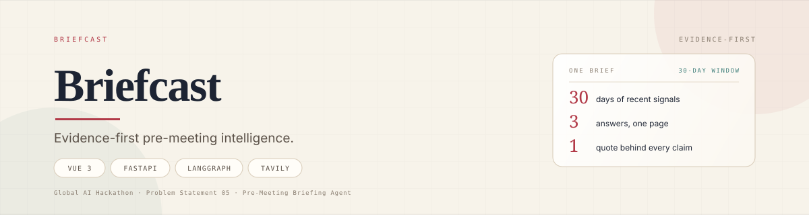
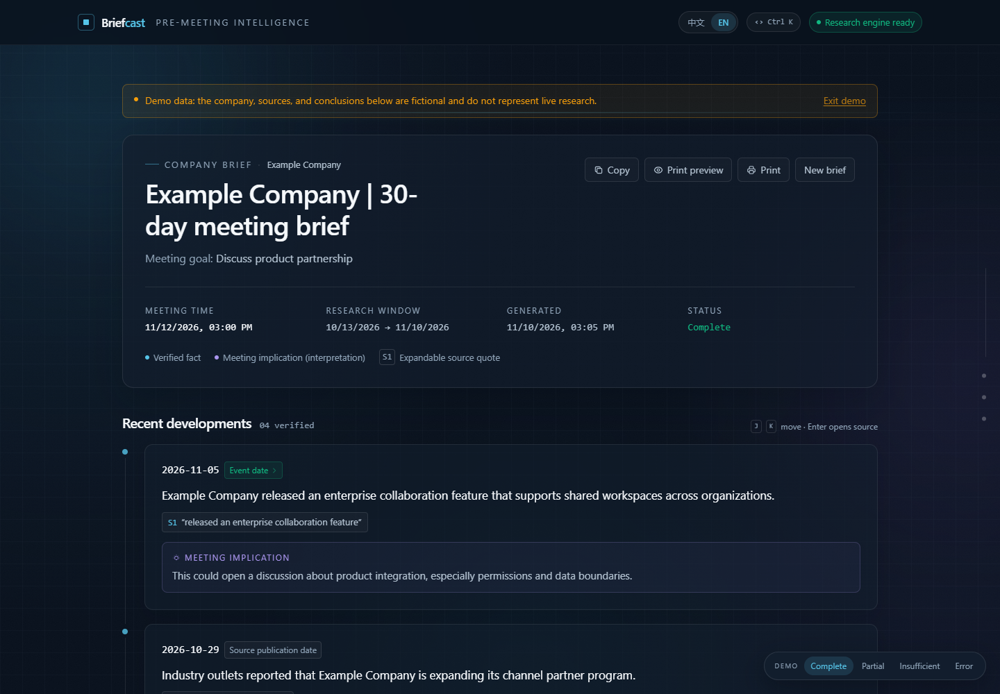
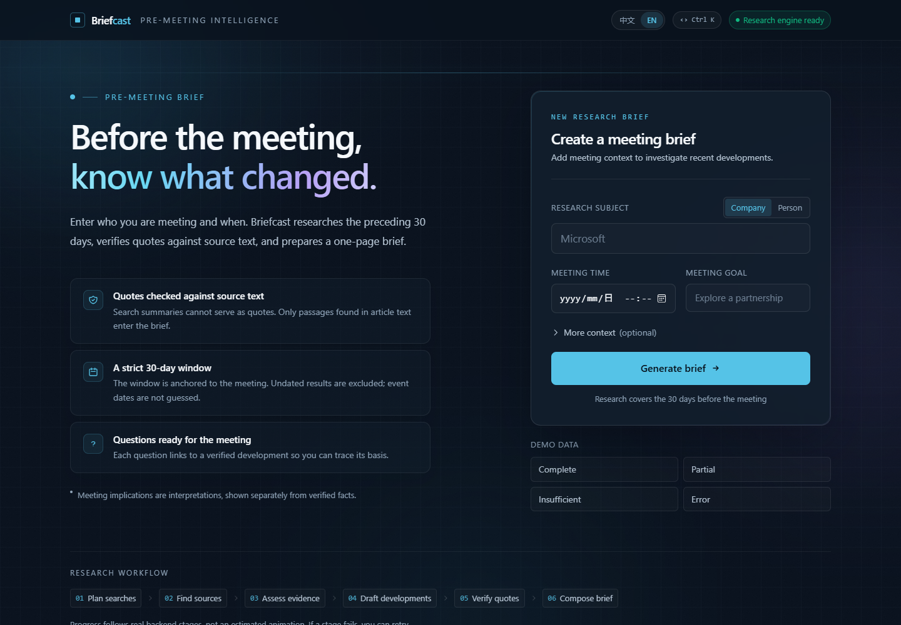
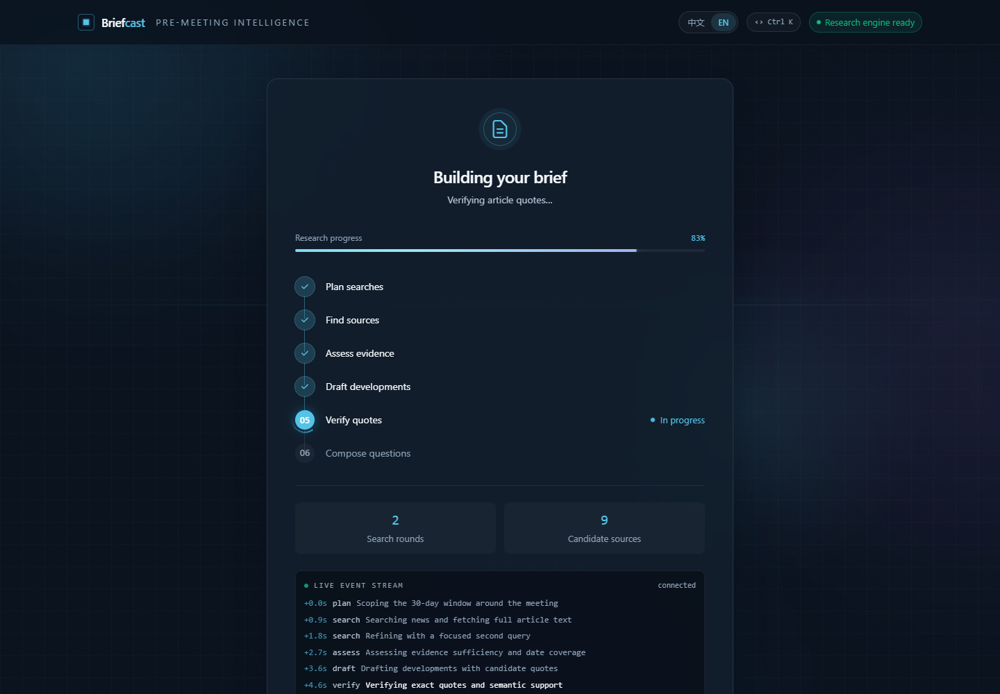
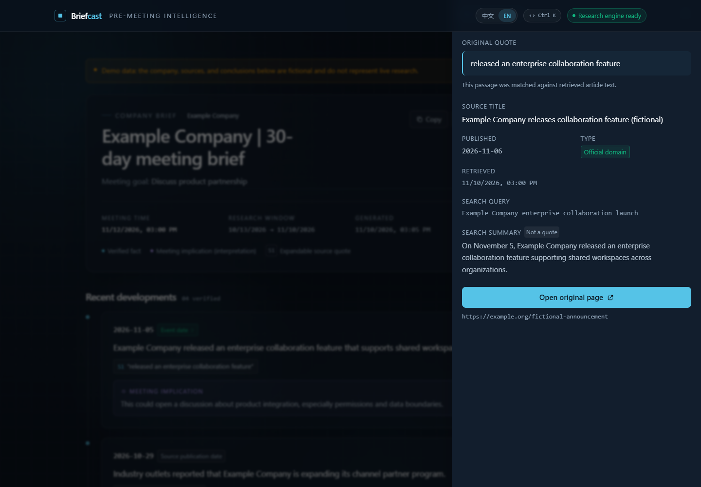
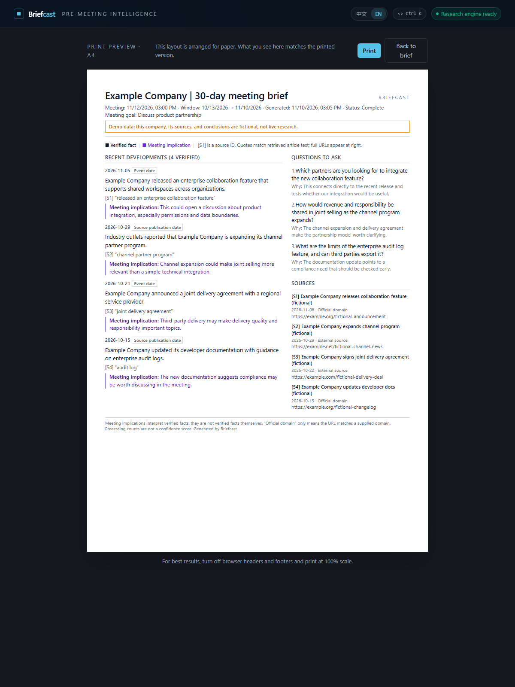
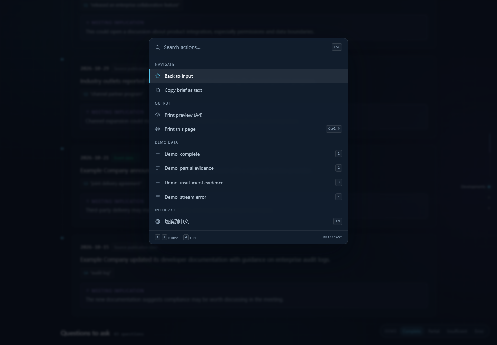
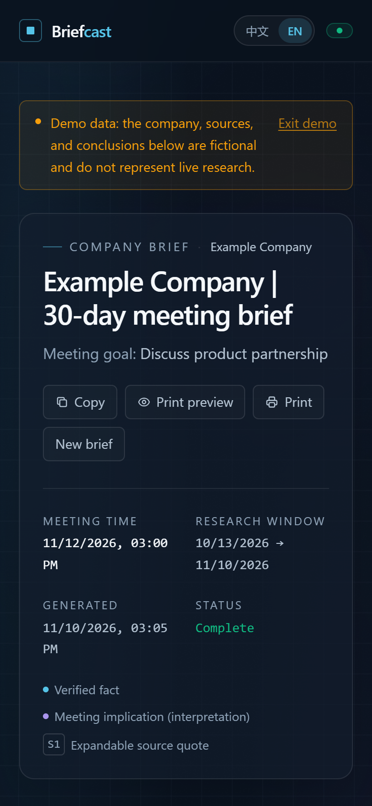
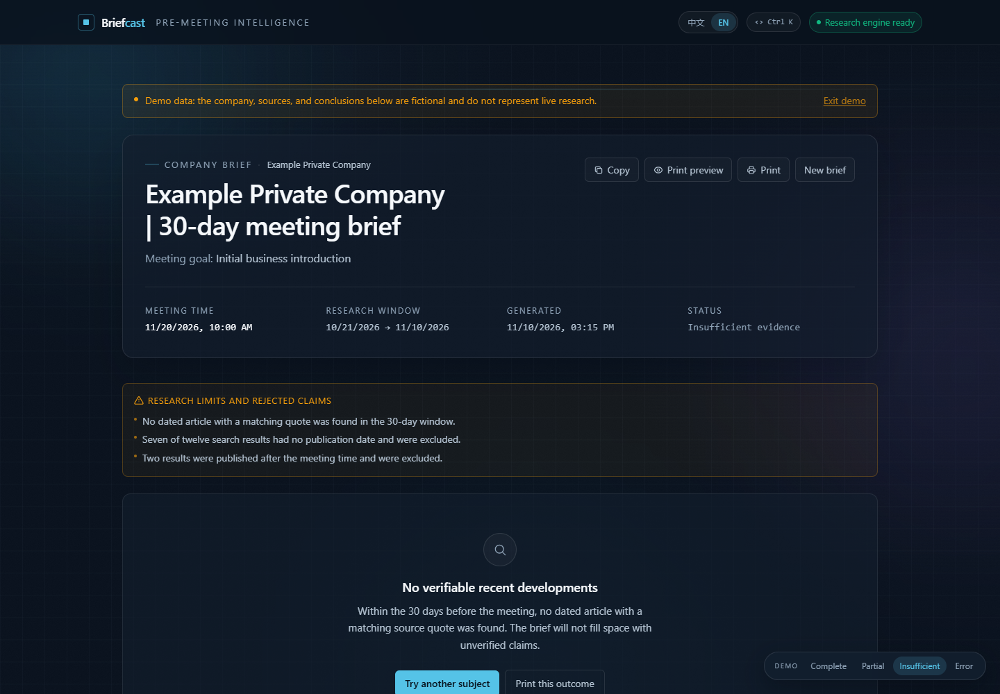
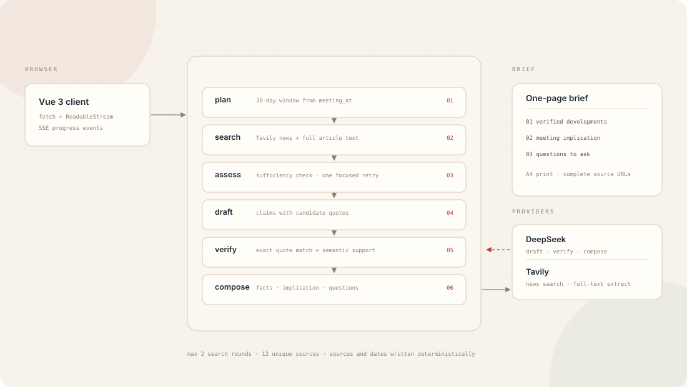

<p align="center">
  
</p>

<p align="center">
  <strong>Evidence-first pre-meeting intelligence.</strong><br>
  Turn the 30 days before a meeting into three answers you can defend.
</p>

<p align="center">
  English · <a href="README.zh-CN.md">简体中文</a>
</p>

---

## The two hours before the meeting

The meeting is not the expensive part. The two hours before it are: scanning news, changelogs and social posts, then trying to remember what the other side actually shipped last month.

Search gives you links. It does not tell you which link matters for *this* conversation, or why you should believe it.

Briefcast makes that process repeatable. Give it a subject, a meeting time and a goal. It researches the 30-day window before the meeting, traces every claim back to a verbatim sentence in the article text, and turns verified facts into questions you can ask out loud.

## What it answers

| | Answer | What you get |
|---|---|---|
| **01** | **What happened** | Up to four verified developments on a timeline, each with a date basis and a source quote |
| **02** | **What it means** | An explicitly framed meeting implication, kept visually separate from the facts |
| **03** | **What to ask** | Up to three questions, each bound to a specific development; one click returns to the evidence |

<p align="center">
  
</p>

## The evidence model

This is not a summarizer with a source list. It is a pipeline that refuses to promote unverified text.

- **Claims need quotes.** Every development carries `[S1]` to a passage that was matched against the retrieved article text.
- **Dates have a basis.** `explicit_event_date` means the article states when it happened; `source_publication` means only the publication date is known.
- **Snippets are not quotes.** Search summaries are labeled as search summaries and never presented as article text.
- **Inference is labeled.** Meeting implications live in their own block, separate from verified facts.
- **Silence is allowed.** If the evidence is insufficient, the brief says `insufficient_evidence` instead of filling the page.

## Product tour

### 01 — Input

Subject and meeting time are all that is required. Company/person type, organization, domain and attendee stay collapsed until you need them.

<p align="center"></p>

### 02 — Live research progress

Progress is not a decorative animation. Six stages (`plan → search → assess → draft → verify → compose`) come from real SSE events pushed by the backend. The live event stream shows the actual elapsed time and source counts for each stage.

<p align="center"></p>

### 03 — Source drawer

Click any `[S1]` citation to open the full source: original quote, title, publication date, source type, retrieval time, search query, search summary (explicitly marked **not a quote**), and the original URL. Date labels are clickable too — they open the sentence that supports the date.

<p align="center"></p>

### 04 — A4 print layout

Printing is not a squeezed webpage. It is a separate newspaper-style layout: developments on the left, questions and sources on the right, with complete URLs for offline reading and meeting notes.

<p align="center"></p>

### 05 — Command palette and keyboard flow

`⌘K` / `Ctrl K` opens the command palette: jump between views, copy the brief, open print preview, switch demo state or change the interface language. On the result page, `J` / `K` move between evidence, `Enter` opens the current source, and `Esc` closes any overlay.

<p align="center"></p>

### 06 — Bilingual by design

Interface, demo data, source notes, copied text and the print layout all support Chinese / English. The choice is stored locally and becomes the default language for new briefs.

<p align="center"></p>

### 07 — Mobile

At phone width the timeline becomes a single column, the reading rail and hover effects turn off, and animations degrade gracefully without losing information density.

<p align="center"></p>

### 08 — Edge states

| State | Behaviour |
| --- | --- |
| `completed` | Normal brief |
| `partial` | Shows verified material and lists the research gaps |
| `insufficient_evidence` | Says there is no verifiable recent activity; **does not fill the page** |
| stream interrupted / `error` | Explains the interruption and offers retry without losing completed work |

<p align="center"></p>

## Architecture

<p align="center"></p>

- The time window is anchored to the **meeting time**, not the calendar month; future dates and results without a parsable publication date are excluded.
- The pipeline allows at most two search rounds and twelve unique sources.
- Models never write URLs or publication dates into the final result: sources and dates are written deterministically by the backend.
- `verify` combines exact quote matching with a second semantic-support check.

## Requirement coverage

| Hackathon requirement | How Briefcast implements it |
| --- | --- |
| **Meeting context** — company/person and meeting time | Company or person input; `meeting_at` requires a timezone; optional organization, domain and attendee disambiguate |
| **Recent research** — last 30 days | Window is **30 days before the meeting**, covering launches, channels, partnerships, people and funding; up to two search rounds |
| **Concise briefing** — one structured page | Single-page screen layout; a separate **one-page A4** print layout (verified with `--print-to-pdf`) |
| **Source attribution** — verifiable facts | Every fact has an `[S1]` quote with expandable excerpt, title, publication date, retrieval time, query and original URL; **search snippets are never treated as quotes** |
| **Open questions** — usable in the meeting | Up to three questions, each bound to a development; click to return to the evidence |
| Guidance — separate verified from uncertain | Facts and meeting implications are separated structurally and visually; quotes are exact-matched and semantically checked; insufficient evidence returns `insufficient_evidence` |
| Guidance — use Tavily | Tavily news search (`topic=news`, date range, full-text extraction) with date, domain and duplicate gates |

> The brief's original warning still holds: AI summaries often present unsupported material as fact. Briefcast treats that as the core problem: **unverified developments never enter the brief**, and every number on screen is a processing count, not a confidence score.

## Quick start

Requirements: Python 3.11+ and Node.js 18+.

```powershell
# 1) Backend
python -m venv .venv
.\.venv\Scripts\python.exe -m pip install -e ".[dev]"
Copy-Item .env.example .env      # add DEEPSEEK_API_KEY / TAVILY_API_KEY
.\.venv\Scripts\python.exe -m uvicorn sourcebound.api:app --reload
```

```powershell
# 2) Frontend (second terminal)
cd frontend
npm install
npm run dev                       # http://localhost:5173
```

Or use `start-dev.bat` / `start-dev.ps1`.

| URL | What it shows |
| --- | --- |
| `http://localhost:5173/` | Input page |
| `http://localhost:5173/briefing` | Real run (SSE progress → brief) |
| `http://localhost:5173/briefing?demo=completed` | Demo state (`partial` / `insufficient` / `error`) |
| `http://localhost:5173/briefing?demo=completed&paper=1` | One-page A4 print preview |

Keys live only in the project-root `.env`. They **never enter frontend code, browser requests or build output**.

## API

| Method | Purpose |
| --- | --- |
| `GET /api/health` | Configuration status; never returns credentials |
| `POST /api/briefing` | Same request body, returns the final JSON |
| `POST /api/briefing/stream` | Main flow: `progress` events, then `result` or `error` |

```json
{
  "entity": "Microsoft",
  "entity_type": "company",
  "official_domain": "microsoft.com",
  "meeting_at": "2026-11-26T15:00:00+08:00",
  "meeting_goal": "Discuss an enterprise AI partnership",
  "language": "en"
}
```

`meeting_at` must include a timezone offset, otherwise the API returns 422. Full contracts: [frontend contract](docs/briefing-frontend-contract.md) and [sample response](docs/briefing-sample.json).

## Engineering notes and limits

Implementation choices and verification records live in [engineering notes](docs/engineering-notes.md); frontend structure and deployment are in [frontend/README.md](frontend/README.md).

- Retrieval can be incomplete. **Results without a parsable publication date are excluded**, even when relevant.
- Exact quote matching proves the sentence was retrieved, not that the interpretation is right; semantic support is model-judged, so sample representative briefs manually.
- Runs are held in memory; there is no history archive.
- Demo data is fictional and always labeled as demo data.

## License

[MIT](LICENSE)

<sub>Built for the Global AI Hackathon · Problem Statement 05 — Build a Pre-Meeting Briefing Agent (Tavily). Demo data is synthetic and labeled in the interface.</sub>
