<p align="center">
  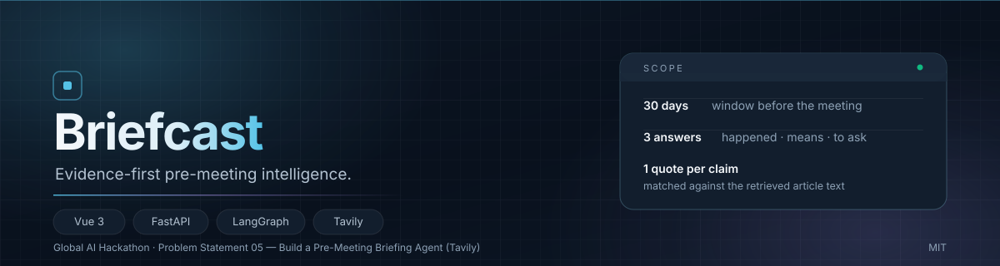
</p>

<p align="center">
  <strong>证据优先的会前研究。</strong><br>
  把会议前的 30 天，压缩成三个你能当场说出口的答案。
</p>

<p align="center">
  <a href="README.md">English</a> · 简体中文
</p>

---

## 开会前的两个小时

会议本身不贵，贵的是会前那两个小时：翻新闻、翻更新日志、翻社交账号，然后在电梯里努力回忆对方上个月到底发布了什么。

通用搜索能给你一堆链接，却不会告诉你哪一条是**这次对话真正用得上**的，更不会告诉你它凭什么可信。

Briefcast 把这件事变成一个可重复的流程。给出研究对象、会议时间和会议目的，它在会议前 30 天的时间窗口里检索公开报道，把每一条事实**回溯到网页正文里的原句**，再把经过核验的事实转成可以直接在会上问出口的问题。

## 它会回答什么

| | 答案 | 你会拿到什么 |
|---|---|---|
| **01** | **最近发生了什么** | 最多四条已核实动态，按时间排列，每条带日期依据与来源引文 |
| **02** | **这对会议意味着什么** | 明确标注的会议推断，与事实在结构上分开 |
| **03** | **会上值得问什么** | 最多三个问题，每个绑定到具体动态；点一下就能回到对应证据 |

<p align="center">
  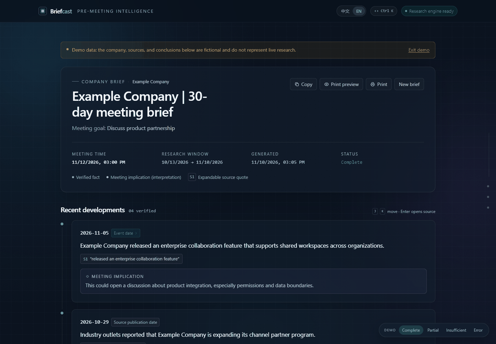
</p>

## 它不是摘要器，而是证据流水线

- **事实必须有引文。** 每条动态都带 `[S1]`，指向与正文精确匹配的原句。
- **日期必须有依据。** `explicit_event_date` 表示文章明确说明了事件发生时间；`source_publication` 表示只知道来源发布日期。
- **搜索摘要不是引文。** 摘要会被明确标注为搜索摘要，绝不冒充原文。
- **推断必须标注。** 会议意义单独成块，不混进已核实事实。
- **允许交白卷。** 证据不足时明确返回 `insufficient_evidence`，不用未核实内容填满版面。

## 技术栈

| 层 | 技术 | 作用 |
|---|---|---|
| 界面 | Vue 3.4、TypeScript、Vite 5、Vue Router 4、Tailwind CSS 3 | 单页简报阅读、演示态、A4 打印版式 |
| 流式通信 | 原生 `fetch()` + `ReadableStream` SSE 解析 | 以 POST 发送 JSON，并实时渲染进度；`EventSource` 只支持 GET |
| 接口 | Python 3.11、FastAPI、Pydantic v2、Uvicorn | 类型化校验、异步接口、`text/event-stream` 响应 |
| 智能体编排 | LangGraph 1.x | 显式的六节点状态机，检索循环有上限 |
| 模型 | DeepSeek `deepseek-flash`（OpenAI 兼容 API） | 查询规划、起草、严格证据审计、问题生成 |
| 检索 | Tavily news search + 正文抓取 | 获取近期报道与可用于引文核验的正文 |
| 质量保障 | pytest、httpx、vue-tsc、GitHub Actions | 36 个后端测试、类型检查与生产构建、每次推送自动 CI |

## 页面导览

### 01 — 输入

只需要研究对象和会议时间。公司/人物类型、所属机构、官网域名、参会人都默认折叠，不打扰主路径。

<p align="center">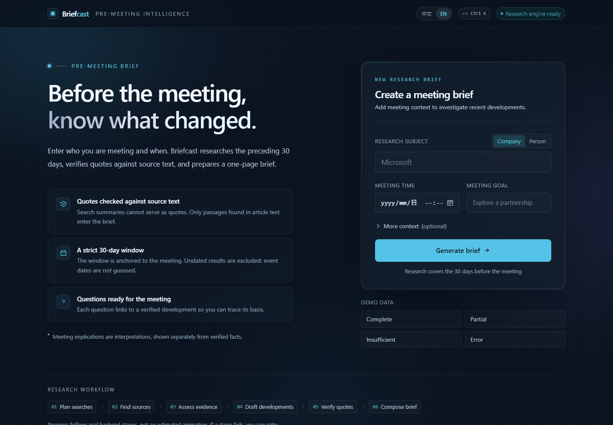</p>

### 02 — 实时研究进度

进度不是装饰动画。`plan → search → assess → draft → verify → compose` 六个阶段来自后端真实推送的 SSE 事件；右下角的实时事件流显示每个阶段的真实耗时与来源数量。

<p align="center">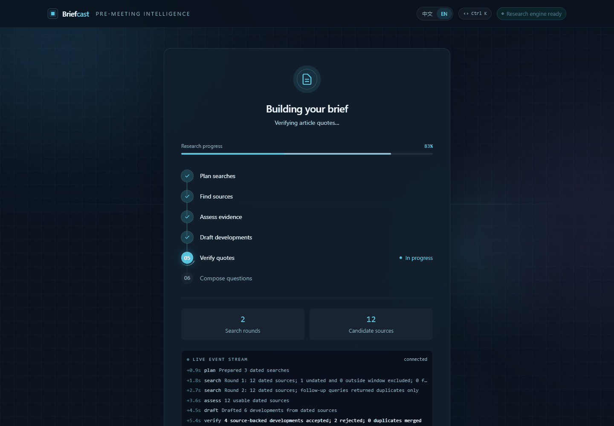</p>

### 03 — 来源侧栏

点击任意 `[S1]` 引文，右侧展开完整来源：原文摘录、标题、发布日期、来源类型、检索时间、检索式、搜索摘要（明确标注**非原文引述**），以及原网页链接。日期标签也可以点开——展开的是支持该日期的原句。

<p align="center">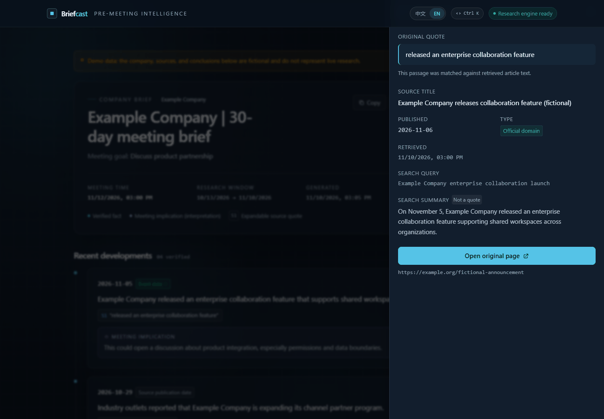</p>

### 04 — 一页 A4 打印版

打印不是把网页压扁，而是一份重新排版的报纸式版面：左栏动态、右栏问题与来源，来源带完整 URL，方便离线阅读与会议记录归档。

<p align="center">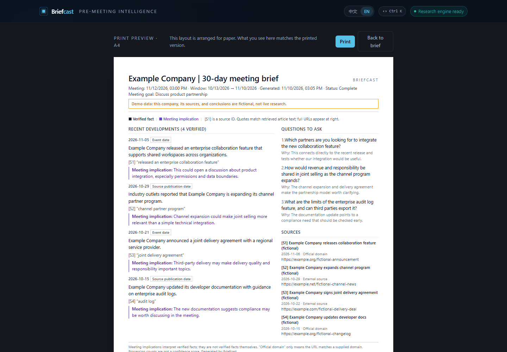</p>

### 05 — 命令面板与键盘操作

`⌘K` / `Ctrl K` 打开命令面板：跳转、复制简报、打印预览、切换演示态与界面语言。结果页用 `J` / `K` 在证据之间移动，`Enter` 打开当前来源，`Esc` 关闭任何浮层。

<p align="center">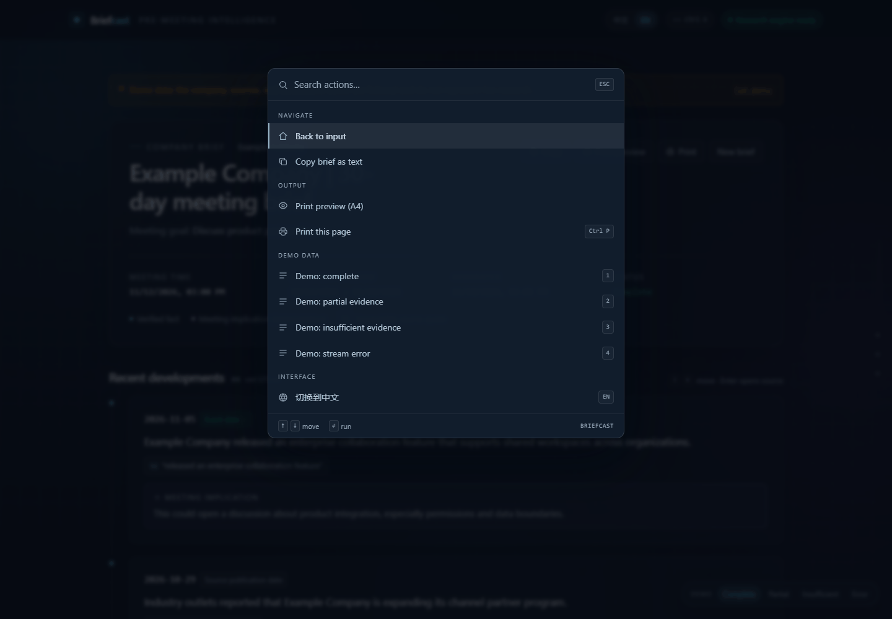</p>

### 06 — 中英双语

界面、演示数据、来源说明、复制文本与打印版均支持中文 / English。语言选择会保存在本地，并作为新建简报的默认正文语言。

<p align="center">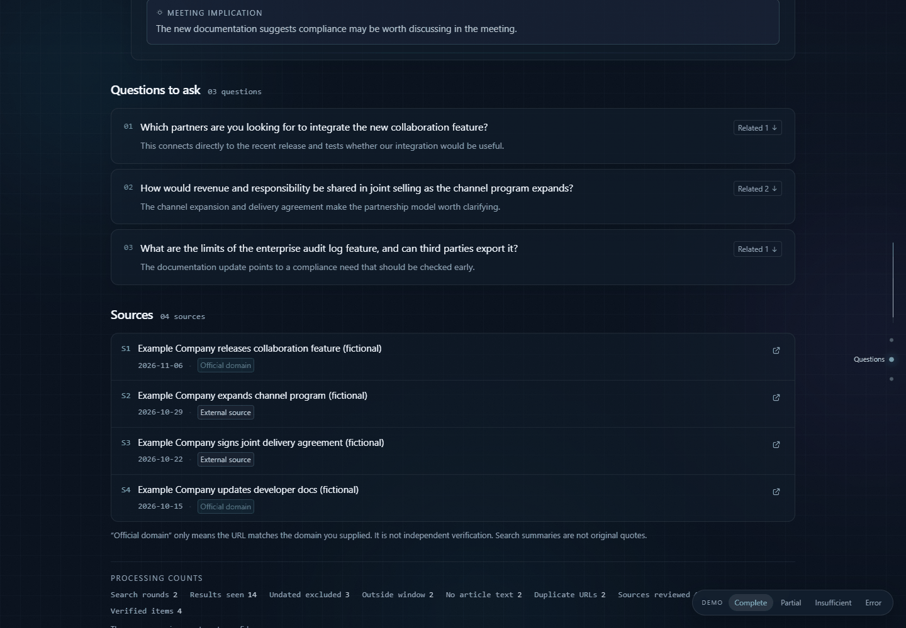</p>

### 07 — 移动端

手机宽度下，时间轴改为单列，章节轨与悬停特效自动关闭，动画降级，信息密度保持一致。

<p align="center">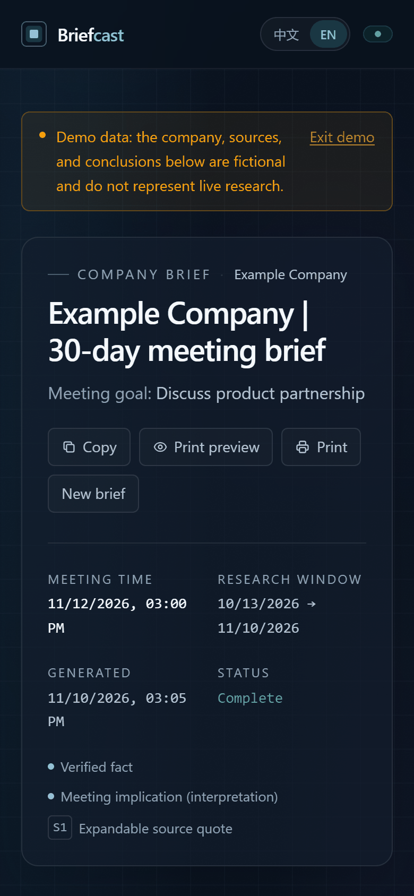</p>

### 08 — 边界状态

| 状态 | 行为 |
| --- | --- |
| `completed` | 正常简报 |
| `partial` | 展示已核实部分，同时列出研究缺口 |
| `insufficient_evidence` | 明确说明没有可核实的近期动态；**不用未核实内容填充版面** |
| 流中断 / `error` | 说明中断原因并允许重试，不丢失已完成信息 |

<p align="center">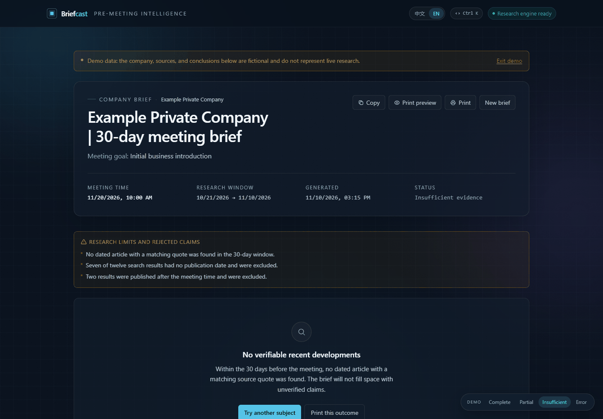</p>

## 架构与实现

<p align="center">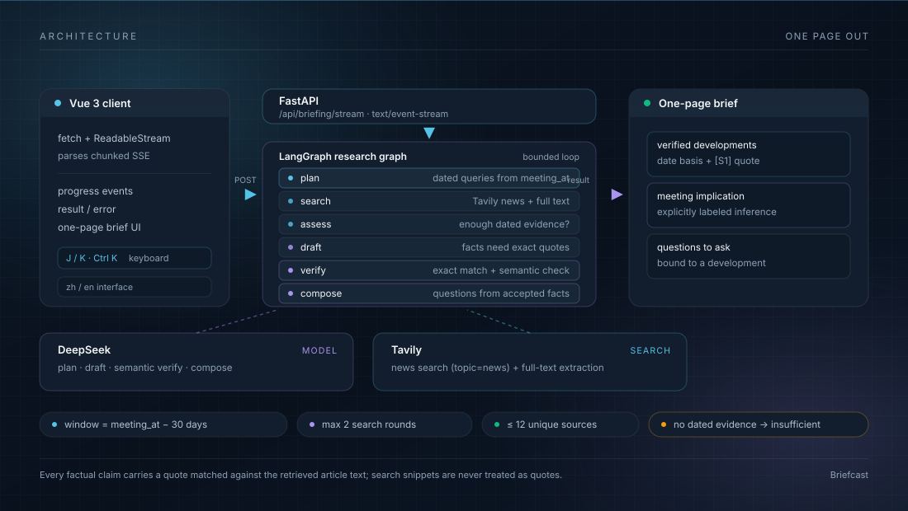</p>

### 请求生命周期

1. Vue 输入页向 `POST /api/briefing/stream` 发送 JSON 请求体。
2. FastAPI 校验 `meeting_at`（必须带时区），并推导研究窗口：`[meeting_at - 30 天, min(meeting_at, 当前时间)]`。
3. LangGraph 状态机依次执行 `plan → search → assess → draft → verify → compose`。
4. 每个节点追加一条 trace；API 把每条 trace 作为 SSE `progress` 事件推送。
5. 浏览器用 `fetch()` + `ReadableStream` 解析事件流，更新六阶段进度，最后渲染 `result`。
6. 屏幕阅读、打印预览与复制文本共用同一个结果对象，不会再次调用模型。

### 流水线阶段

| 阶段 | 做什么 | 约束 |
|---|---|---|
| `plan` | 基于研究对象、会议目的和时间窗口，最多生成三条针对性新闻查询；提供官网域名时补充一条 `site:` 查询。 | 窗口完全位于未来时直接返回 `insufficient_evidence`，不发起检索。 |
| `search` | 调用 Tavily news search（`topic=news`、advanced 深度、抓取正文）；规范化 URL 并去重。 | 最多两轮、十二个唯一来源；无日期、超出窗口、无正文的结果会被剔除。 |
| `assess` | 判断带日期证据是否足够；不足时提出针对性补充查询。 | 达到三个可用带日期来源或两轮上限即停止，循环有界。 |
| `draft` | 要求模型最多生成四条不同动态：事实、会议含义、精确引文、可选事件日期及日期引文。 | 明确禁止把搜索摘要当作引文。 |
| `verify` | 逐条核对引文是否存在于正文；校验事件日期、主体身份与 30 天窗口；检测重复；再做一次严格证据审计。 | 无支撑、主体模糊或超出窗口的候选会被剔除；最终最多保留四条已核实动态。 |
| `compose` | 生成绑定到具体动态 ID 的会议问题，并写入最终状态。 | 没有已核实动态 → `insufficient_evidence`；存在材料缺口 → `partial`；否则 `completed`。 |

### 确定性组装

来源层不允许由模型自由编造：

- URL、标题、发布日期、检索时间与来源类型由后端根据 Tavily 元数据写入。
- `date_basis` 只会是 `explicit_event_date`（文章明确写出事件日期）或 `source_publication`（以发布日期作为代理）。
- 搜索摘要单独保存，并明确标注“搜索摘要，非原文引述”。
- 界面上的数字是检索/拒绝计数，不是可信度评分。

### 前端实现

- Vue 3 Composition API + 模块级 composable，让输入页与结果页共享同一次运行状态。
- 因为 `EventSource` 只支持 GET，前端手写 SSE 解析：跨 chunk 缓冲行、处理 `progress` / `result` / `error` 事件。
- `PrintBriefing` / `PaperPreview` 用同一份结果渲染独立的 A4 报纸式版面。
- 命令面板、证据键盘导航（`J` / `K`）、减少动态效果降级、移动端单列布局均在客户端实现。

### 目录结构

```text
src/sourcebound/
  api.py          FastAPI 应用、CORS、SSE 接口
  briefing.py     六节点 LangGraph 简报流水线
  providers.py    DeepSeek 与 Tavily 适配器
  schemas.py      Pydantic 请求/响应模型
frontend/src/
  api/client.ts   POST + ReadableStream SSE 解析
  composables/    共享运行状态、语言、演示模式
  components/     简报、来源侧栏、打印、进度、命令面板
  views/          输入页与简报页
tests/            36 个使用 fake provider 的后端测试
docs/             契约、评估记录、工程说明
```

## 赛题要求对照

| 赛题要求 | Briefcast 的实现 |
| --- | --- |
| **Meeting context** — 公司/人物与会议时间 | 支持公司或人物；`meeting_at` 必须带时区；可选所属机构、官网域名、参会人用于消歧 |
| **Recent research** — 最近 30 天 | 以**会议时间倒推 30 天**为窗口，覆盖发布、渠道、合作、人事、融资等；最多两轮检索 |
| **Concise briefing** — 一页结构化报告 | 屏幕版单页阅读；独立的**一页 A4** 打印版式（已用 `--print-to-pdf` 验证） |
| **Source attribution** — 事实可核验 | 每条事实带 `[S1]` 引文，可展开原文摘录、标题、发布日期、检索时间、检索式与原网页链接；**搜索摘要不被当作原文引述** |
| **Open questions** — 会上可用的问题 | 最多三个问题，每个绑定具体动态，点击即可回到对应证据 |
| 指引 — 区分已核实与不确定信息 | 事实与会议推断在结构与视觉上分离；引文经正文精确匹配 + 语义二次判定；证据不足时明确交白卷 |
| 指引 — Tavily 提供检索能力 | 使用 Tavily news 检索（`topic=news` + 日期区间 + 正文抓取），结果经日期、域名、重复三重闸门 |

> 赛题原文提醒「AI 生成的摘要常常把没有支撑的信息当作事实」。Briefcast 把这一点当成核心命题：**没有通过核验的动态不会进入简报**，界面上的每个数字都是处理计数，不是可信度评分。

## 安装

### 环境要求

- Python 3.11+
- Node.js 18+（推荐 20 LTS）
- 真实研究需要 DeepSeek API Key 与 Tavily API Key
- Windows PowerShell、macOS 或 Linux，下面分别给出命令

### 1. 克隆并配置

```powershell
git clone https://github.com/97Three/briefcast.git
cd briefcast
Copy-Item .env.example .env      # Windows PowerShell
```

```bash
git clone https://github.com/97Three/briefcast.git
cd briefcast
cp .env.example .env             # macOS / Linux
```

| 变量 | 必填 | 默认值 | 用途 |
|---|---|---|---|
| `DEEPSEEK_API_KEY` | 是 | — | 规划、起草与核验所需的 DeepSeek 模型调用 |
| `TAVILY_API_KEY` | 是 | — | Tavily news 检索与正文抓取 |
| `DEEPSEEK_MODEL` | 否 | `deepseek-flash` | 传给 OpenAI 兼容接口的模型名 |
| `DEEPSEEK_BASE_URL` | 否 | `https://api.deepseek.com` | API 基础地址 |
| `FRONTEND_ORIGINS` | 否 | `http://localhost:3000,http://localhost:5173` | CORS 允许来源 |
| `VITE_API_BASE_URL` | 否 | 空（同源 `/api`） | 仅用于前后端分域部署；严禁写入密钥 |

密钥只写在项目根 `.env`，**不会进入前端代码、浏览器请求或构建产物**。

### 2. 启动后端

Windows：

```powershell
python -m venv .venv
.\.venv\Scripts\python.exe -m pip install -e ".[dev]"
.\.venv\Scripts\python.exe -m uvicorn sourcebound.api:app --reload
```

macOS / Linux：

```bash
python3 -m venv .venv
source .venv/bin/activate
python -m pip install -e ".[dev]"
python -m uvicorn sourcebound.api:app --reload
```

API 默认监听 `http://127.0.0.1:8000`。

### 3. 启动前端

另开一个终端：

```bash
cd frontend
npm install
npm run dev
```

Vite 默认在 `http://localhost:5173` 提供服务，并把 `/api` 代理到 `127.0.0.1:8000`。Windows 下也可以直接用 `start-dev.bat` / `start-dev.ps1` 启动前后端。

### 4. 验证安装

```bash
curl http://127.0.0.1:8000/api/health
```

预期返回：

```json
{"status":"ok","deepseek_configured":true,"tavily_configured":true}
```

打开页面即可运行真实研究，或使用下面的演示态。演示模式不需要 API Key；未配置密钥时真实研究会返回 HTTP 503。

| 入口 | 内容 |
| --- | --- |
| `http://localhost:5173/` | 输入页 |
| `http://localhost:5173/briefing` | 真实运行（SSE 进度 → 简报） |
| `http://localhost:5173/briefing?demo=completed` | 演示态（`partial` / `insufficient` / `error`） |
| `http://localhost:5173/briefing?demo=completed&paper=1` | 一页 A4 打印预览 |

### 常见问题

| 现象 | 处理 |
|---|---|
| 真实研究返回 503 | 在 `.env` 中补齐两个 Key，并重启 Uvicorn |
| 返回 422 | `meeting_at` 必须带时区偏移，例如 `+08:00` |
| 前端请求不到接口 | 确认后端在 8000 端口，或修改 `frontend/vite.config.ts` 中的 `/api` 代理 |

## 接口

| 方法 | 说明 |
| --- | --- |
| `GET /api/health` | 服务配置状态，不返回任何凭据 |
| `POST /api/briefing` | 同一请求体，直接返回最终 JSON |
| `POST /api/briefing/stream` | 主流程：`progress` 事件流，最终 `result` 或 `error` |

```json
{
  "entity": "Microsoft",
  "entity_type": "company",
  "official_domain": "microsoft.com",
  "meeting_at": "2026-11-26T15:00:00+08:00",
  "meeting_goal": "讨论企业 AI 产品合作",
  "language": "zh"
}
```

`meeting_at` 必须带时区偏移，否则返回 422。完整契约见 [前端契约](docs/briefing-frontend-contract.md) 与 [演示样例](docs/briefing-sample.json)。

## 测试

```powershell
# 后端：36 个测试，使用 fake 模型/检索 provider，不需要 API Key
.\.venv\Scripts\python.exe -m pytest -q

# 前端：TypeScript 检查 + 生产构建
cd frontend
npm run build
```

GitHub Actions 会在每次 push 与 pull request 时运行上述两个任务。评估记录与代表性简报见 [简报评估](docs/briefing-evaluation.md) 与 [工程说明](docs/engineering-notes.md)。

## 工程说明与已知局限

实现细节、设计取舍与逐项验证记录见 [工程说明](docs/engineering-notes.md)；前端结构、数据语义与部署方式见 [前端文档](frontend/README.md)。

- 检索可能不完整；**缺少可解析发布日期的结果会被排除**，即使它相关。
- 精确引文匹配只能证明"这句话确实被抓取到了"，不能证明解读正确；语义支持由模型判定，仍建议对代表性简报做人工抽样。
- 每次运行结果保存在内存中，不提供历史归档。
- 演示数据为虚构样例，界面始终带演示标记。

## 许可证

[MIT](LICENSE)

<sub>为 Global AI Hackathon · Problem Statement 05 — Build a Pre-Meeting Briefing Agent (Tavily) 而做。演示数据为虚构样例，界面中已标注。</sub>
